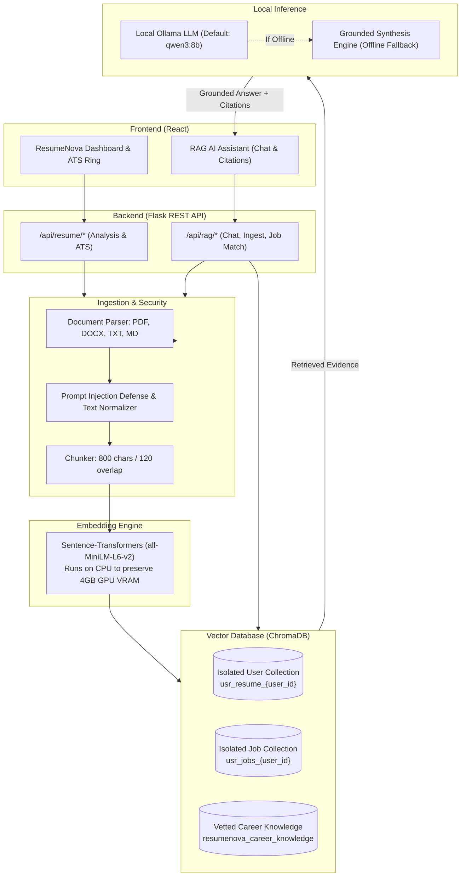

# ResumeNova — AI Resume Analyzer & RAG Career Assistant

ResumeNova is a full-stack AI resume analyzer and Retrieval-Augmented Generation (RAG) career copilot for job seekers. It reviews PDF/DOCX resumes, calculates ATS readiness scores, extracts technical skills, identifies keyword gaps, compares job descriptions, and provides an evidence-grounded AI Career Assistant powered by local inference.

---

## Architecture Overview



---

## Key Features

1. **AI Career Assistant (RAG)**:
   - Grounded Q&A strictly based on your uploaded resume and vetted career knowledge.
   - Exact source citations: document name, section hint, and page numbers.
   - States explicitly when information is absent to eliminate hallucinations.
   - Automated recruiter introduction pitch generation.
2. **Personal Resume Ingestion & Storage**:
   - Parses PDF, DOCX, TXT, and Markdown documents.
   - Enforces strict user isolation — your resume data is never mixed with other users.
   - Duplicate ingestion prevention via SHA-256 content hashing.
3. **Job Description RAG**:
   - Compares job requirements against your stored resume chunks.
   - Identifies matched skills, missing skills, and qualification gaps.
   - Produces a prioritized learning roadmap with verified citations.
4. **Career Knowledge Base**:
   - 12 pre-ingested reference guides covering Python, SQL, Machine Learning, System Design, STAR Method, ATS Optimization, and Placement Preparation.
5. **ATS Scoring & Live Dashboard**:
   - Animated ATS score ring, formatting checks, and career readiness breakdown.
   - Action plan with priority, effort, and step-by-step fix recommendations.
   - Application kit generator with cover note bullets and submission checklist.
6. **Local-First & Privacy-Minded**:
   - Zero required paid OpenAI API keys.
   - Optimized for local development laptops (e.g., AMD Ryzen 7, NVIDIA RTX 3050 4GB VRAM, 16GB RAM) using CPU embeddings and local Ollama inference.

---

## Technology Stack

- **Large Language Model**: [Ollama](https://ollama.ai/) with `qwen3:8b` (configurable)
- **Embeddings**: `sentence-transformers` (`all-MiniLM-L6-v2`, 384 dimensions)
- **Vector Database**: `ChromaDB` (Persistent file storage)
- **Document Extractors**: `pdfplumber`, `python-docx`
- **Backend**: Python 3.12, Flask 3.1, Flask-CORS
- **Frontend**: React 18, Axios, Modern Responsive CSS
- **Testing**: `pytest` (Backend), `react-scripts test` (Frontend)

---

## Getting Started

### 1. Prerequisites
- **Python**: 3.10+ (Recommended: Python 3.12)
- **Node.js**: v18+ and npm
- **Ollama**: (Optional but recommended for full local LLM inference)

### 2. Ollama Installation & Setup

1. Download and install Ollama from [ollama.ai](https://ollama.ai/download).
2. Start the Ollama server:
   ```powershell
   ollama serve
   ```
3. Pull the default generation model:
   ```powershell
   ollama pull qwen3:8b
   ```
   *(Or any model of your choice, such as `llama3:8b` or `mistral`)*

> **Note**: If Ollama is not installed or offline, ResumeNova automatically switches to its built-in deterministic grounded synthesis engine with exact document citations.

---

### 3. Backend Setup (Windows PowerShell)

```powershell
# Navigate to backend directory
cd backend

# Create and activate virtual environment (optional if using global python)
python -m venv venv
.\venv\Scripts\Activate.ps1

# Install dependencies
pip install -r requirements.txt

# Copy environment variables
Copy-Item .env.example .env

# Run the Flask server
python app.py
```

Backend will be accessible at:
```text
http://127.0.0.1:5000
```

Verify backend health:
```powershell
Invoke-RestMethod -Uri "http://127.0.0.1:5000/api/health"
Invoke-RestMethod -Uri "http://127.0.0.1:5000/api/rag/status"
```

---

### 4. Frontend Setup (Windows PowerShell)

In a separate PowerShell terminal:

```powershell
# Navigate to frontend directory
cd frontend

# Install node packages
npm install

# Build for production
npm run build

# Start the React development server
npm start
```

Frontend will open automatically at:
```text
http://localhost:3000
```

---

## Environment Variables

Configure via `backend/.env`:

| Variable | Default Value | Description |
| :--- | :--- | :--- |
| `OLLAMA_BASE_URL` | `http://localhost:11434` | Ollama local server API URL |
| `RAG_LLM_MODEL` | `qwen3:8b` | Ollama model name |
| `RAG_EMBEDDING_MODEL` | `all-MiniLM-L6-v2` | Sentence-Transformers embedding model |
| `RAG_EMBEDDING_DEVICE` | `cpu` | Device for embeddings (`cpu` preserves GPU VRAM) |
| `RAG_ENABLED` | `true` | Enable or disable RAG functionality |
| `RAG_TOP_K` | `5` | Maximum number of chunks retrieved per query |
| `RAG_CHUNK_SIZE` | `800` | Target chunk size in characters |
| `RAG_CHUNK_OVERLAP` | `120` | Overlap between consecutive chunks |
| `RAG_VECTOR_DB_PATH` | `backend/data/chroma` | Persistence directory for ChromaDB |
| `RAG_SIMILARITY_THRESHOLD` | `0.35` | Minimum cosine similarity score for retrieval |

---

## Running the Automated Test Suite

### Run Backend Tests (pytest)

```powershell
$env:PYTHONPATH="backend"
python -m pytest backend/tests -v
```
All 35 automated test cases verify document parsing, chunking, embedding generation, ChromaDB vector store isolation, semantic retrieval, prompt injection defense, grounded Q&A, and existing ResumeNova endpoints.

### Run Frontend Tests

```powershell
npm --prefix frontend test -- --watchAll=false
```

### Build Frontend for Production

```powershell
npm --prefix frontend run build
```

---

## Security & Data Privacy Safeguards

- **User Isolation**: Resumes and query histories are partitioned by authenticated username. No user can access or search another user's documents.
- **Prompt Injection Defense**: Sanitizes adversarial override commands embedded in uploaded resumes or job listings.
- **Zero Hallucination Grounding**: Prompts enforce that answers are drawn strictly from retrieved context chunks.
- **No Private Data Leaks**: Uploaded resumes, ChromaDB storage files, and environment secrets are excluded via `.gitignore`.

---

## Additional Documentation

- [RAG Architecture Deep Dive](docs/RAG_ARCHITECTURE.md)
- [RAG API Endpoints Reference](docs/RAG_API.md)

---

## License

MIT License. Designed and developed by [Chethan N](https://github.com/ChethanNGowda).
